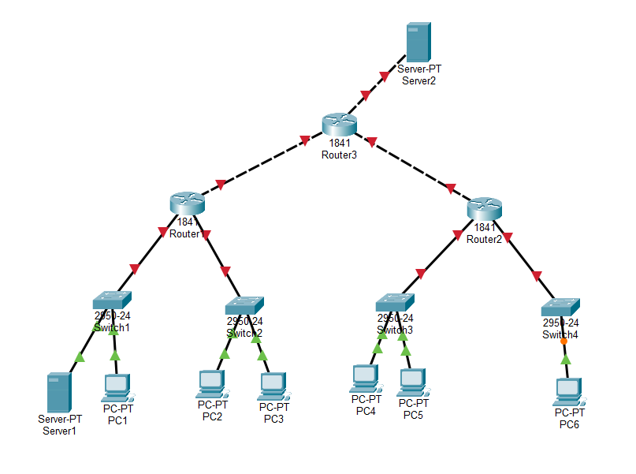
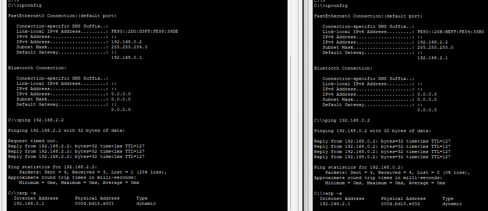
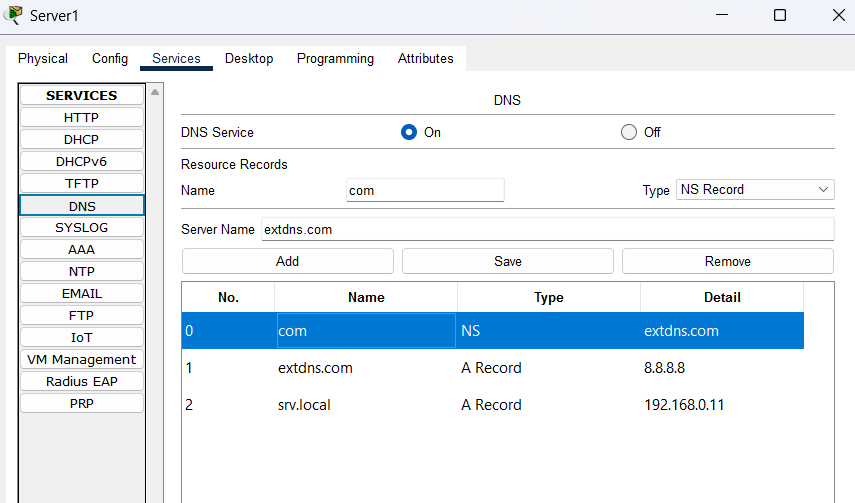
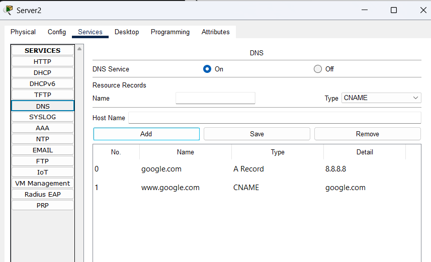
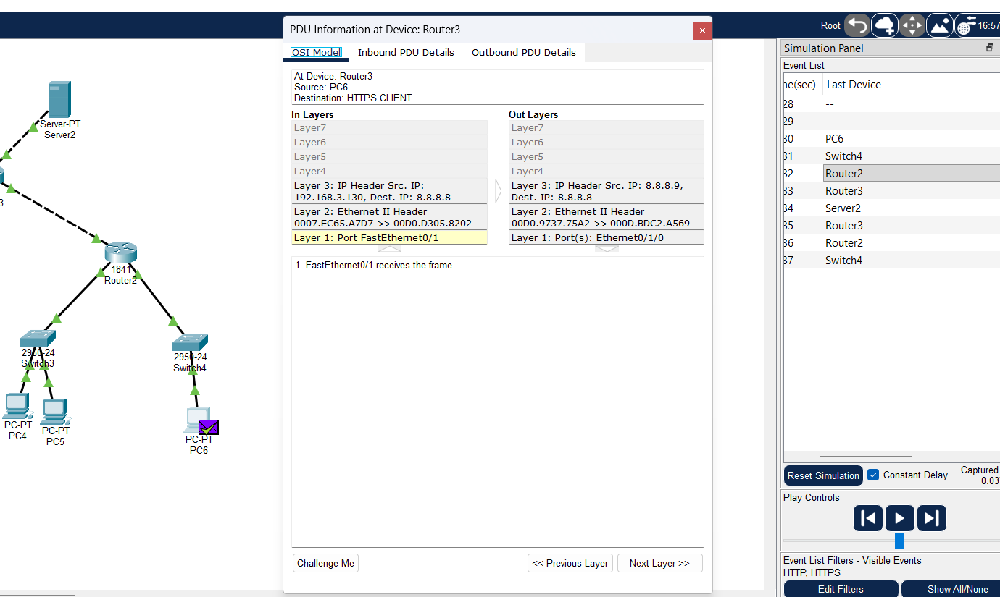

# Экзамен
## Билет 15. «Итоговый комплексный»
- 4 подсети, 3 роутера, 4 коммутатора, 6 ПК, 2 сервера (DNS + HTTP/HTTPS).
- VLSM-планирование.
- ARP, MAC-таблицы на всех сегментах.
- Статическая маршрутизация.
- DHCP на каждом роутере.
- NAT/PAT на пограничном.
- DNS-иерархия, все типы записей.
- Проверка HTTP/HTTPS, TCP/UDP.
- **Отчёт:** полная документация сети + анализ инкапсуляции.

## 1. Топология сети
Для начала я придумал топологию сети:



4 - switch это 4 подсети, 
* в первой подсети находится ПК1 и внутренний сервер
* 2 - 4 подсети просто switch и ПК

Во все роутеры добавлен третий интерфейс WIC-1ENET

* подсеть 1 и 2 обслуживает router 1
* подсеть 3 и 4 обслуживает router 2
* router3 - граничный роутер
* Server2 - сервер в интернете

**Упрощение**:
router3 - обслуживает "весь internet" т.е. у него нет маршрутов наружу.

## Распределение адресов

Допустим дана сеть:

192.168.0.0/22

Распределим ее на 4 разные подсети VLSM и одну подсеть для роутеров

| № | Адрес сети | Адрес роутера | Адреса хостов |
| --- | --- |  --- | --- |
| 1 | 192.168.0.0/23   | 192.168.0.1     | 192.168.0.2 - 192.168.1.254 |
| 2 | 192.168.2.0/24   | 192.168.2.1     | 192.168.2.2 - 192.168.2.254 |
| 3 | 192.168.3.0/25   | 192.168.3.1     | 192.168.3.2 - 192.168.3.126 |
| 4 | 192.168.3.128/26 | 192.168.3.129   | 192.168.3.130 -192.168.3.190 |

Для роутеров с конца откусим две подсети по 4 адреса.

сети для роутеров
| сеть             |  роутер1      |         роутер2 |    роутер3 |
| --- | --- |  --- | --- |
| 192.168.3.248/30 | 192.168.3.249 |        192.168.3.250 |      - |
| 192.168.3.252/30 | 192.168.3.253 |            -    |     192.168.3.254 |


## 2. Настройка DHCP

Настроил

```
ip dhcp excluded-address 192.168.0.1
ip dhcp excluded-address 192.168.0.11
ip dhcp excluded-address 192.168.2.1
ip dhcp pool POOL1
net 192.168.0.0 255.255.254.0
default-router 192.168.0.1
dns-server 192.168.0.11
exit
ip dhcp pool POOL2
net 192.168.2.0 255.255.255.0
default-router 192.168.2.1
dns-server 192.168.0.11
exit
```

Проверил связь пк1 - пк2 и их адреса




## 3. Настройка маршрутизации и NAT

```
int fa 0/0
ip nat in
exit
int fa 0/1
ip nat in
exit
int et 0/1/0
ip nat out
exit
acc 1 perm 192.168.0.0 0.0.3.255
ip nat in sou li 1 int et 0/1/0 ov
```


```
ip route 192.168.0.0 255.255.254.0 192.168.3.250
ip route 192.168.2.0 255.255.255.0 192.168.3.250
ip route 192.168.3.0 255.255.255.128 192.168.3.254
ip route 192.168.3.128 255.255.255.192 192.168.3.254
```


### 4. DNS






## 5. HTTPS



