# Домашняя работа 11 по теме
# Технология NAT

## Описнаие сети

Я построил такую сеть: 

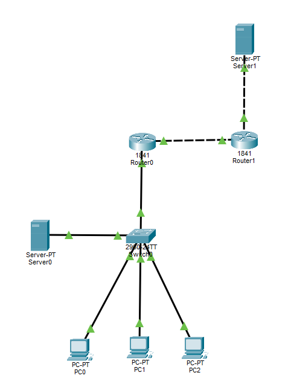

Исходник схемы: [sch1](src/sch1.pkt)


* 3 компьютера PC0 - PC2 имеют серые IP адреса 192.168.1.x/24 (x от 2 до 4) default gateway 192.168.1.1 и подключены к switch0
* server0 имеет серый IP адрес 192.168.2.2/24 default gateway 192.168.2.1


## настройка внутренних (серых) подсетей и vlan

1. Установил через gui ip адреса и default gateway у PCx

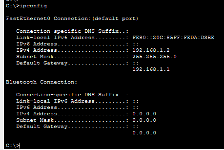

2. Установил через gui ip адреса и default gateway у Server0

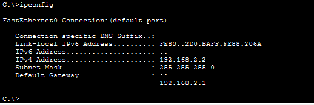

3. Настроил switch0

* Добавил через gui в switch0 два vlan

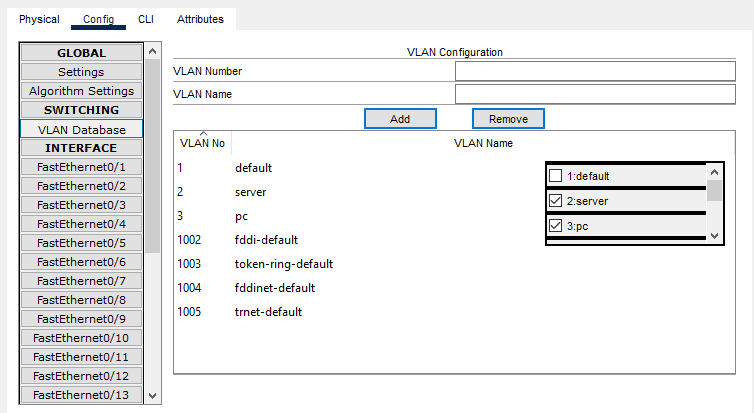

* Распределил через qui порты switch0 по vlan, Fa0/1 подключен к роутеру поэтому он trunk

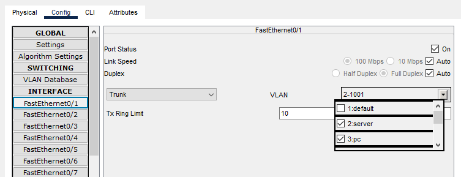

4. Настроил Router0

Т.к. через qui настроить vlan в роутере не получится, я включил интерфейс через gui потом ввел команды:

```
int fa 0/0.2
enc dot1q 2
ip add 192.168.2.1 255.255.255.0
exit
int fa 0/0.3
enc dot1q 3
ip add 192.168.1.1 255.255.255.0
end
```

У меня получилась такая конфигурация

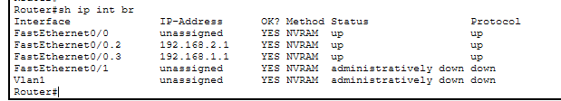


5. Проверил ping между PC0 и Server0

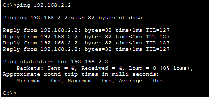

## настройка белых подсетей

Допустим провайдер нам вдыал IP 176.195.233.202/30
default gateway будет 176.195.233.201

У server1 будет адрес 176.195.233.206/30, default gateway будет 176.195.233.205

1. Настроил ip адреса на роутерах и сервере 1 и проверил ping к default gateway

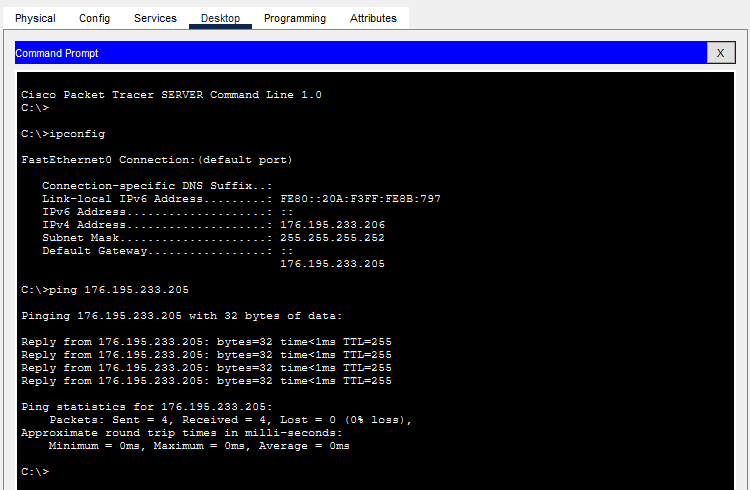

2. На роутере 0 

* добавил маршрут по умолчанию

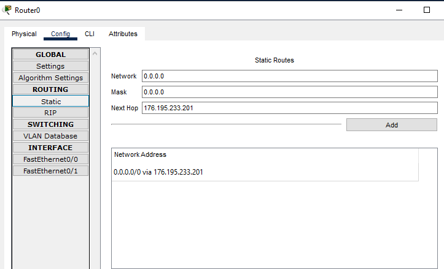

* И проверил связь с server1

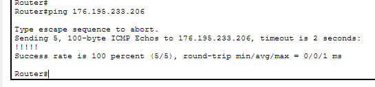


## Настройка nat overload

на роутере0 прописал команды

```
int fa 0/0.3
ip nat in
exit
int fa 0/1
ip nat out
exit
acc 1 perm 192.168.1.0 0.0.0.255
ip nat in sou li 1 int fa 0/1 ov
```

Проверил связь между PC0 и Server1

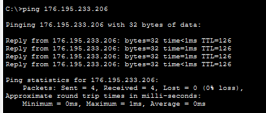

Увидел статистику трансляций адреса

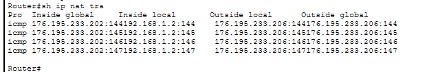

## Проброс порта

Настроил проброс порта 80 на внтуренний сервер

```
ip nat inside source static tcp 192.168.2.2 80 176.195.233.202 80
```

Проверил доступность server0 c server1, по адресу 176.195.233.202 - который выдал провайдер.


