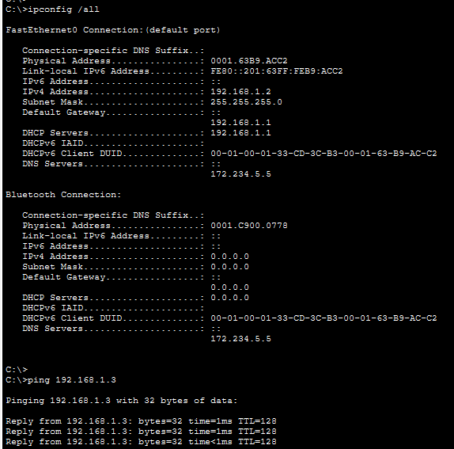
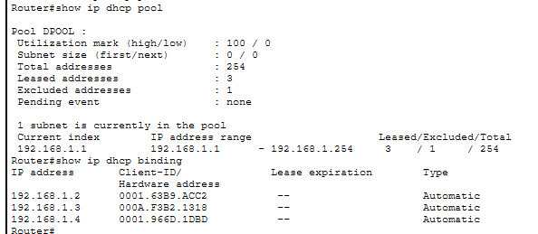
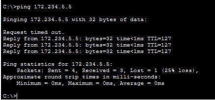
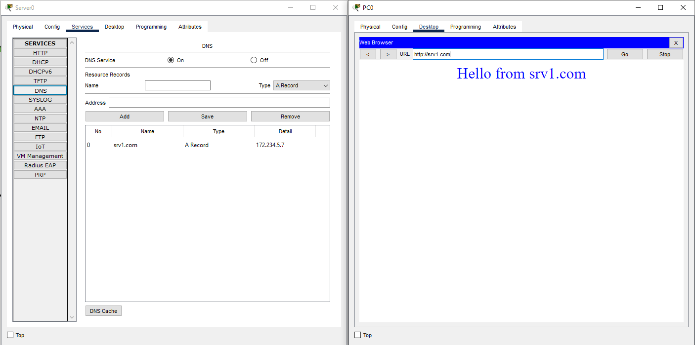
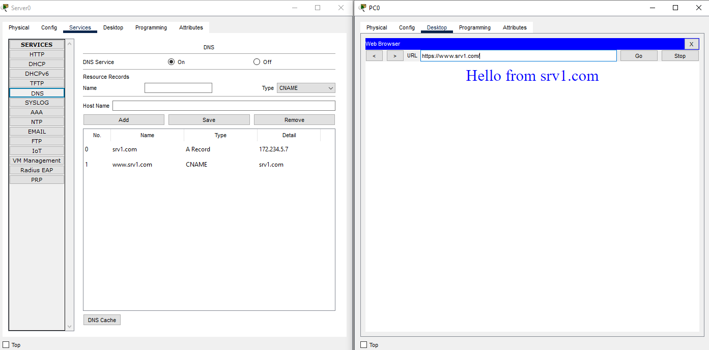
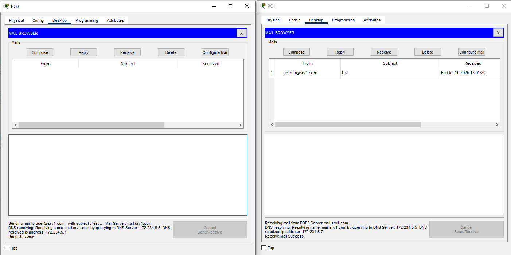
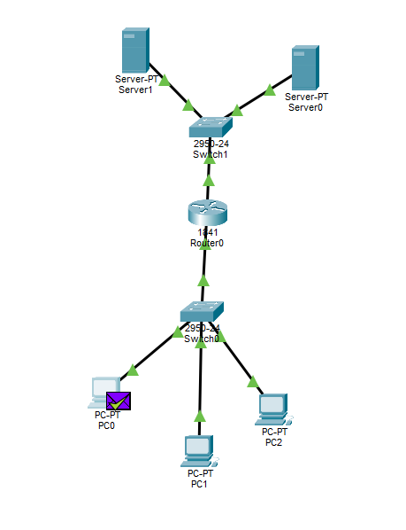

# Домашняя работа 12 по теме
# DNS 

## Внутренняя сеть

Для начала я настроил router0 switch0 и три компьютера

В роутере настроил DHCP
```
Router(config)#ip dhcp excluded-address 192.168.1.1
Router(config)#ip dhcp pool DPOOL
Router(dhcp-config)#net 192.168.1.0 255.255.255.0
Router(dhcp-config)#default-router 192.168.1.1
Router(dhcp-config)#dns-server 172.234.5.5
Router(dhcp-config)#exit
```
Что бы он выдавал не только ip адрес, но и адоеса default gateway и dns.

На PC0 проверил получение IP default gateway и dns,  и ping с другим PC



И посмотрел статистику dhcp



## Настройка nat

Допустим провайдер нам выдал адрес 172.234.5.2/24 (для простоты я не буду ставить еще роутер т.е. у меня прям с этого роутера будет достпен "весь интернет")

Настроил nat
```
Router(config)#int fa 0/0
Router(config-if)#ip nat in
Router(config-if)#exit
Router(config)#int fa 0/1
Router(config-if)#ip nat out
Router(config-if)#exit
Router(config)#acc 1 perm 192.168.1.0 0.0.0.255
Router(config)#ip nat in sou li 1 int fa 0/1 ov
```

Проверил что ping на будующий dns сервер проходит (172.234.5.5) т.е. NAT настроен верно.



## Настройка dns

* Добавил A запись, проверил с PC0 доступность http сервера по имени



* Добавил CNAME запись и проверил https://www.srv1.com/



* Настроил почту
Т.к. MX записей в packet tracer нет, я настроил CNAME запись mail.srv1.com -> srv1.com


Внизу виден статус что почта отправлена и получена, DNS запросы.

## Итоговая схема

Запустил симуляцию для https запроса, все прошло



Исходник схемы [sch1](src/sch1.pkt)

