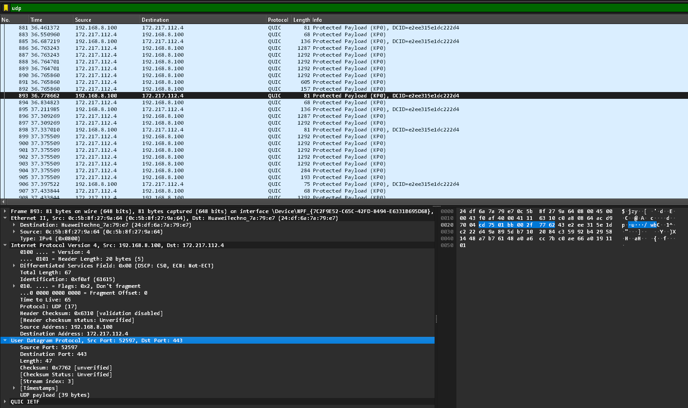
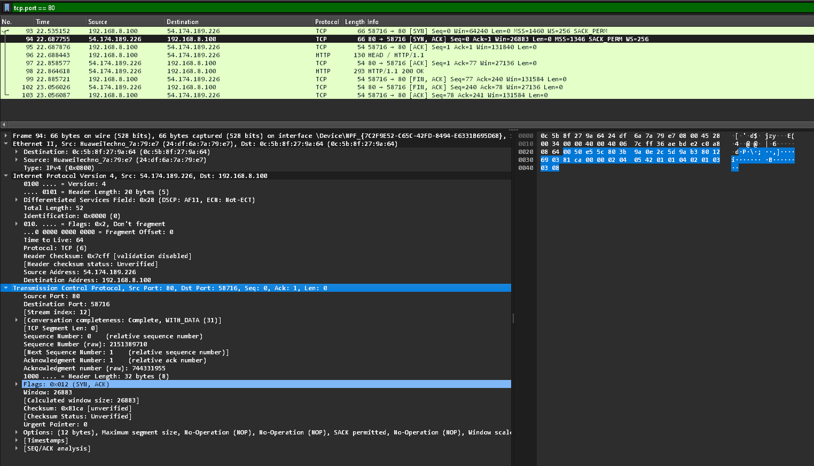
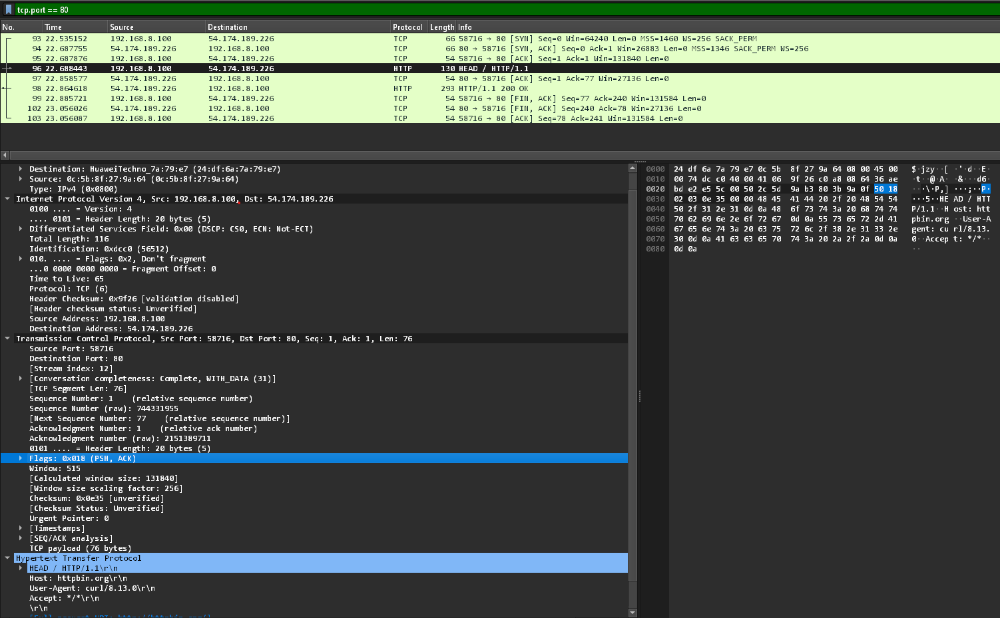

# Домашняя работа Порты, сетевые сокеты и состояние соединений

# Просмотр пакетов транспортного уровня в wireshark

## UDP

Я сделал скриншот UDP-пакета, внутри которого инкапсулирован протокол QUIC



На нем выделен заголовок UDP, который занимает 8 байт: по два байта на порт отправителя, порт получателя, длину пакета и контрольную сумму. Таким образом, по сравнению с сетевым уровнем (IP), транспортный уровень UDP добавляет только порты для адресации процессов (приложений)

## TCP

Что бы не просто сделать 2 скриншота, а посмотреть полный цикл TCP. Я с помощью curl сделал HEAD запрос.
```
curl -I http://httpbin.org
```

На первом скриншоте второй пакет - подтверждение запроса на соединение и запрос в ответ.



Так же на скриншоте выделен заголовк TCP и видно что он намного дилнне и сложнее UDP заголовка. В данном пакете заголовк занимает 32 байта (потому что еще есть опции).


На втором скриншоте - первый пакет по протоколу HTTP - у него флаги PSH и ACK



Здесь уже заголовк имеет минимальный размер 20 байт.

На верхней части скриншотов видно как поисходит TCP соединение по последовательности изменения флагов:

1. Установление соединения (Тройное рукопожатие / 3-way handshake)
* Пакет 1: [SYN] — curl инициирует соединение.
* Пакет 2: [SYN, ACK] — сервер httpbin.org отвечает, что готов.
* Пакет 3: [ACK] — компьютер подтверждает получение. Соединение установлено.

2. Обмен данными (HTTP HEAD)
* Пакет 4: [PSH, ACK] — HTTP HEAD запрос (поместился в один пакет)
* Пакет 5: [ACK] — сервер подтверждает, что запрос дошел.
* Пакет 6: [PSH, ACK] — ответ сервера (HTTP/1.1 200 OK) с заголовками.

3. Закрытие соединения
* Пакет 7: [FIN, ACK] — Не только подтверждение примема данных но и закрытие соединения.
* Пакет 8: [FIN, ACK] — сервер подтверждает и одновременно закрывает со своей стороны.
* Пакет 9: [ACK] — компьютер шлет финальное подтверждение.
